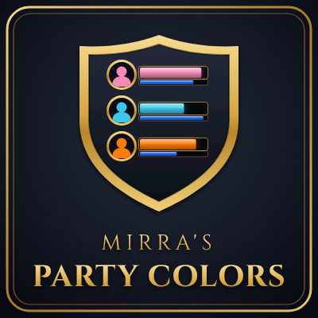

  

# Mirra's Party Colors

**Class colors for the original Blizzard party frames.**

A lightweight addon for **WoW Forever**. It colors the health bars (and optionally the names) of your party members in their class color – on the original party frames, not the raid-style frames.

## Features

- Class-colored health bars on the original party frames
- Optional class-colored names
- Optional flat bar texture for stronger colors
- Offline party members are shown in gray
- Settings panel under **Options → AddOns** with a live preview (dummy party that updates instantly)
- Supports `CUSTOM_CLASS_COLORS` if another addon provides it
- No changes to Blizzard code or tables – safe against taint

## Installation

1. Download the latest release (or clone this repository).
2. Copy the folder into your AddOns directory so the path is:
   `World of Warcraft/_retail_/Interface/AddOns/MirrasPartyColors/`
3. Restart the game or type `/reload`.

> **Note:** The option **"Use Raid-Style Party Frames"** must be disabled in the Blizzard options, otherwise the original party frames are not shown.

## Usage

Open the settings with `/mpc` or via **Options → AddOns → Mirra's Party Colors**.

| Setting | Default | Description |
|---|---|---|
| Class-colored health bars | on | Colors the health bars in the class color |
| Class-colored names | off | Also colors the name above each party frame |
| Flat bar texture | off | Uses a plain texture instead of the desaturated Blizzard texture |

### Commands

| Command | Description |
|---|---|
| `/mpc` | Open the settings panel |
| `/mpc toggle` | Toggle class-colored health bars |
| `/mpc name` | Toggle class-colored names |
| `/mpc flat` | Toggle the flat bar texture |

## Compatibility

- **Game:** WoW Forever (Interface `16001`)
- **Frames:** Original party frames only (`PartyFrame`), not `CompactPartyFrame` / raid frames
- **Language:** English

## Files

| File | Purpose |
|---|---|
| `MirrasPartyColors.toc` | Addon metadata |
| `MirrasPartyColors.lua` | Addon code |
| `Logo.tga` | In-game addon icon |
| `mirras_partycolors_curseforge_logo.png` | CurseForge logo |

Settings are saved per account in `MPC_DB`.

## Author

Kekshaus · [GitHub](https://github.com/LinzN)
